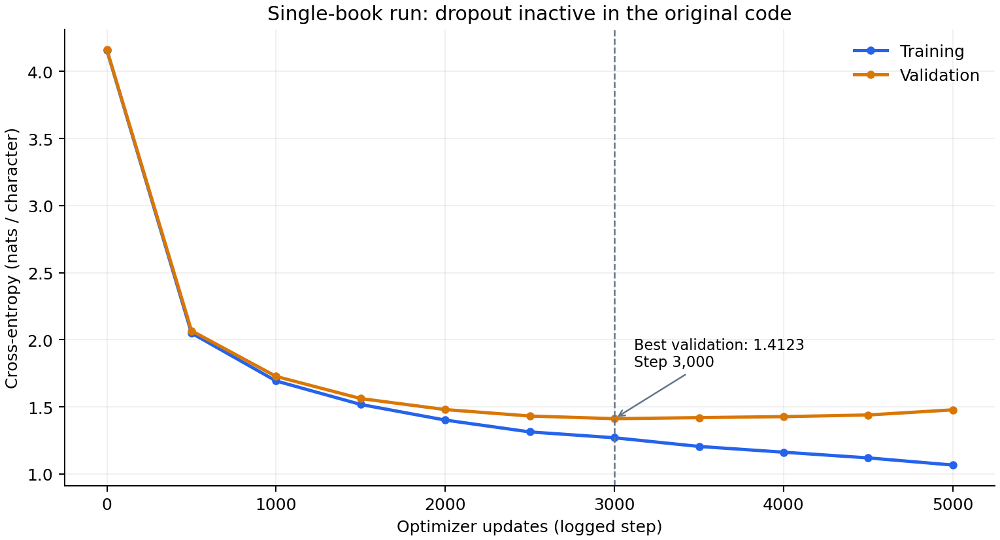

# Tiny GPT from Scratch

An 832,350-parameter character-level GPT that learns nature writing, built from basic PyTorch operations to make attention, training, and generation understandable.

**Actual output from the expanded-corpus experiment** (prompt: `The `, temperature: `1.0`; unedited, including the mid-word ending):

> The vanish to drift-cover, then from the Canada River to the night tide. It is a few missionaries, a thin canoe a piece for a thousand of its ripen plant six widely us, the vast immensation of the scale c

The model learns words and local writing patterns, but spelling, grammar, repetition, and paragraph coherence remain unreliable. This is an educational implementation, not a factual writing assistant.

## What is implemented

Character encoding, learned token and position embeddings, causal scaled dot-product attention, multiple attention heads, feed-forward layers, pre-layer normalization, residual connections, autograd training, checkpoint selection, and autoregressive sampling. No pretrained weights, Hugging Face models, `nn.MultiheadAttention`, or prebuilt Transformer blocks are used.

| Setting | Value |
| --- | --- |
| Parameters | **832,350**, counted from the model with vocabulary size 94 |
| Transformer blocks / attention heads | 4 / 4 per block |
| Embedding / head / feed-forward width | 128 / 32 / 512 |
| Context | 128 characters |
| Batch size | 16 sequences; 2,048 next-character targets per update |
| Optimizer | AdamW; learning rate 0.001; weight decay 0.01 |
| Dropout | 0.2 on each residual branch in the corrected implementation |
| Evaluation | Every 500 updates; 20 batches per split |
| Early stopping | Four evaluations without improvement; retain lowest validation loss |
| Limits | 10,000 updates or 900 seconds; a final evaluation/save may exceed the time cap |
| Device | CPU by default and in the reported original training code |

For the default batch, token IDs have shape `[16, 128]`, hidden states `[16, 128, 128]`, and logits `[16, 128, 94]`. Cross-entropy receives `[2048, 94]` logits and `[2048]` target IDs.

**Correction to the historical experiment:** the original code created a dropout layer but never called it. It also computed each attention/feed-forward branch twice and discarded one result. The current code fixes both mistakes. The reported 1.2459 loss predates this correction; it is not a measured result for the corrected training implementation. Existing checkpoints still load and produce the same evaluation-mode predictions because dropout has no parameters and is disabled in evaluation mode.

## Quick start

Use a Python virtual environment and install the captured project dependencies:

```bash
python -m pip install -r requirements.txt
```

The cleaned corpus files `data/train.txt` and `data/val_fixed.txt` must be present. Train a fresh model:

```bash
python -u train.py --checkpoint nature_gpt_v2.pt --run-dir runs/v2 --seed 42
```

This deliberately uses a new checkpoint name to preserve the original experiment. Existing output paths are refused unless `--overwrite` is explicitly supplied. This command does not resume training from an existing checkpoint.

Generate from the new checkpoint:

```bash
python generate.py --checkpoint nature_gpt_v2.pt --prompt "The forest" --temperature 0.7 --top-k 20 --max-new-tokens 300 --seed 42
```

To use an existing historical checkpoint instead:

```bash
python generate.py --checkpoint nature_gpt.pt --prompt "The forest" --temperature 0.7 --seed 42
```

Omit `--prompt` for interactive input. Temperature must be positive; lower values favor higher-scoring characters. `--top-k` restricts each choice to the k highest-scoring characters; omit it to sample the full vocabulary. It applies to characters, not words. `--top-k 1` is greedy decoding and can repeat. The seed controls sampling, not model quality. Unknown prompt characters produce a clear error.

Checkpoints are excluded from Git. No downloadable checkpoint release is supplied; a new user must train their own unless they already have a compatible local checkpoint. Existing `nature_gpt.pt` files are never needed merely to inspect the code or compute count-based baselines.

## Results and baselines

Best **reported** expanded-corpus validation loss: **1.2459 nats/character**, or **1.7975 bits/character** (`loss / ln(2)`). Lower is better. Bits per character describes average negative log probability here, not measured compressed file size.

The following baselines were measured on the checked-in corpus. Unigram frequencies ignore context; bigram frequencies condition on the preceding character. Both use training counts only and add-one smoothing.

| Model | Nats/character | Bits/character | Evaluation |
| --- | ---: | ---: | --- |
| Uniform over 94 characters | 4.5433 | 6.5546 | All validation targets |
| Unigram | 3.0384 | 4.3835 | All validation targets |
| Bigram | 2.3942 | 3.4541 | All validation targets |
| Tiny GPT, historical report | 1.2459 | 1.7975 | Randomly sampled validation windows |

These are reference values, **not a matched head-to-head benchmark**: the full original checkpoint and final run log were unavailable for independent reevaluation. The historical GPT result used a different sampling protocol. Do not infer an exact improvement over the bigram row from this table.

Recompute baselines without training:

```bash
python evaluate.py --output runs/baselines.json
```

For a matched comparison on every validation target, supply your checkpoint:

```bash
python evaluate.py --checkpoint nature_gpt.pt --output runs/comparison.json
```

This evaluates characters 1 through the end of validation exactly once for every model. GPT context resets at each nonoverlapping block. The JSON includes nats, BPC, parameter count, corpus hashes, and the measured bigram-minus-GPT difference. This result may differ from the historical random-window score. See [the measured baseline report](docs/baselines.json).

## Loss curve and learning history



This is the **earlier single-book run**, not the final three-book experiment. Its log records best validation loss **1.4123 at step 3,000**, stopping at step 5,000 after **399.0 seconds**. Training loss kept falling while validation worsened. Dropout was inactive due to the original bug. A diagnostic optimizer update occurred before logged step 0 in that script. Source values: [CSV](docs/single_book_history.csv).

The final expanded-corpus run's complete curve, best step, duration, and training seed were not preserved in the supplied evidence. No missing points or durations have been invented.

New runs write `metrics.csv`, `metadata.json`, and `samples.jsonl` to their run directory. Samples use the same prompt, temperature, and seed at every evaluation, including step 500; they do not consume the training random-number stream. This enables a genuine within-run before/after comparison.

Plot a new run:

```bash
python plot_loss.py runs/v2/metrics.csv --output docs/v2_loss.png --title "Expanded corpus, corrected dropout"
```

The plotter also accepts a console log containing one run. It never invents missing evaluations.

## Corpus

| Partition | Characters | Whitespace-delimited words |
| --- | ---: | ---: |
| Training | 1,286,809 | 224,757 |
| Validation | 32,591 | 5,656 |

Vocabulary: **94 unique characters**, from the sorted union of both partitions. Character counts differ from UTF-8 byte counts.

John Muir source texts (dates below are Project Gutenberg release dates):

- [My First Summer in the Sierra](https://www.gutenberg.org/ebooks/32540) — 2010-05-26.
- [Travels in Alaska](https://www.gutenberg.org/ebooks/7345) — 2005-01-01.
- [The Mountains of California](https://www.gutenberg.org/ebooks/10012) — 2003-11-01.

Source pages list these works as public domain in the USA. Gutenberg boilerplate and selected front/back matter were stripped from the model inputs, bracketed illustrations removed, and wrapped lines joined within paragraphs. The first book's last 10% remains validation. Added paragraphs sharing an exact 20-word sequence with validation were excluded; this does not detect all overlap. Details, attribution, and source terms: [data/SOURCES.md](data/SOURCES.md).

Validation has been used repeatedly for model selection and is not an untouched test set. Historical prose may also contain dated language and viewpoints.

## Files

- `model.py` — hand-built attention, feed-forward, Transformer blocks, and TinyGPT.
- `train.py` — training, early stopping, checkpoints, metrics, samples, and environment records; replaces `inspect_data.py`.
- `generate.py` — checkpoint loading and interactive or command-line sampling.
- `evaluate.py`, `plot_loss.py`, `tests/`, `data/`, `docs/` — evaluation, plots, regression tests, corpus, and recorded evidence.

## Reproducibility and checks

The captured project requirements pin PyTorch **2.14.0**. The original Python version and exact CPU/chip were not recorded; the supplied terminal log identifies a MacBook Air, and the original code ran on CPU. The final three-book runtime is unknown. The 399.0-second figure belongs only to the plotted single-book run.

New runs default to seed **42**, deterministic PyTorch algorithms, and CPU. They record Python/PyTorch versions, system/architecture, available processor description, thread count, corpus hashes, configuration, elapsed time, completed steps, best step, and stopping reason. Seeds do not guarantee identical results across different platforms or library versions. Use `--threads` to record and control CPU threading.

The corrected code was smoke-tested with **Python 3.12.14 / PyTorch 2.14.1+cpu on Linux x86_64**. This was a short functional test, not a reproduction of the historical quality result.

```bash
python -m unittest discover -s tests -v
```

Tests cover full-model causality, active dropout and branch call counts, nonzero attention gradients, shifted targets, deterministic evaluation, top-k sampling, context cropping, and old-config loading. The training save check compares evaluation-mode prompt logits captured before saving the best weights with logits from a freshly reconstructed model loaded from disk using `torch.allclose`; it separately verifies the vocabulary list. These checks establish consistency, not linguistic correctness.

## Credits and further learning

The architectural foundation is the Transformer described in [Attention Is All You Need](https://arxiv.org/abs/1706.03762) (Vaswani et al., 2017). The project was developed incrementally as a learning exercise with AI-assisted mentoring and debugging.

Andrej Karpathy's [Let's build GPT / ng-video](https://github.com/karpathy/ng-video) and [nanoGPT](https://github.com/karpathy/nanoGPT) are useful further-learning references. They are listed as resources, not as a claim that this project's source was copied from or directly follows a particular tutorial. No external GPT implementation is imported.

## License

Project code and documentation: [MIT](LICENSE). Source books and Gutenberg editions have separate provenance and terms described in [data/SOURCES.md](data/SOURCES.md); they are not relicensed as project-authored material.
